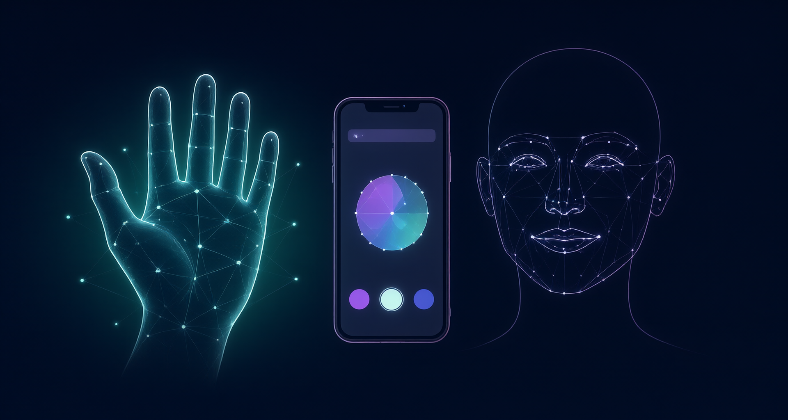
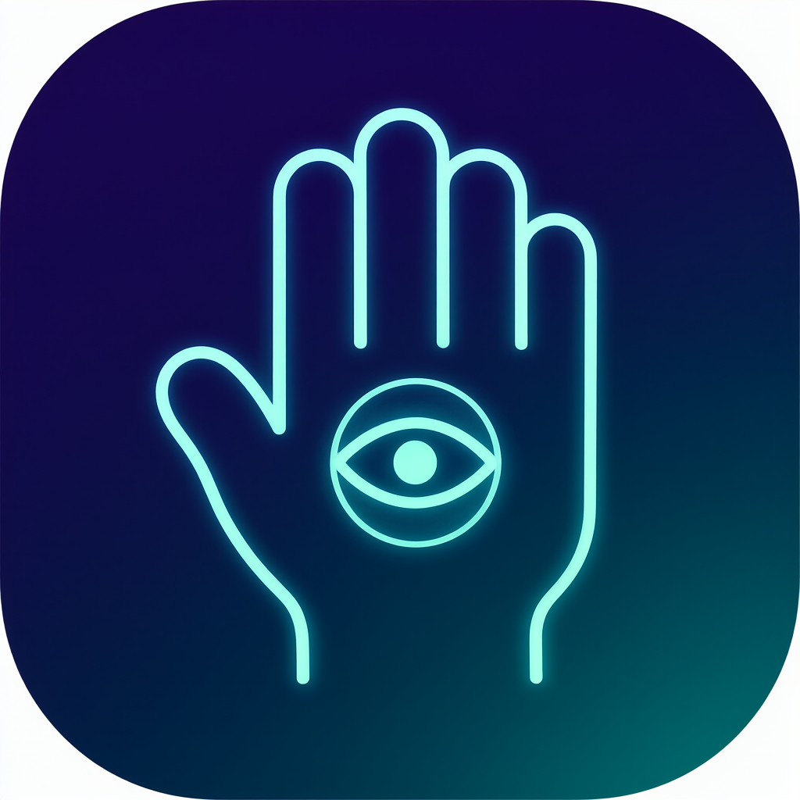

<p align="center"></p>

<h1 align="center"> NoTouch</h1>

<p align="center"><b>Control your whole Android phone without touching it.</b><br>
Hand gestures and facial expressions from the front camera become taps, swipes, Back, Home and Recents, in any app.</p>

<p align="center">


</p>

## What it is

NoTouch is an Android accessibility service. It watches the front camera with [MediaPipe](https://ai.google.dev/edge/mediapipe) hand and face landmark models, recognises a small set of gestures, and performs the matching action system-wide through Android's accessibility gesture API. It is useful for hands-free use (cooking, workshop, gloves), reducing touch on shared screens, and as an alternative input method.

## Features

- **Hand mode**: point to move a cursor, hold still to click, pinch and spread to zoom, twist to rotate, swipe with two fingers or an open palm.
- **Face and head mode**: move your head to move the cursor, then open your mouth, raise eyebrows, smile, pucker or blink to trigger actions.
- **Both mode** combines the two.
- **Media and volume**: bind any gesture to play/pause, next, previous or volume.
- **Remappable gestures**: every gesture is bound to an action through a saved table (screen to edit it is planned; defaults below).
- **Works in any app**: taps, swipes, Back, Home and Recents are injected through an accessibility service.
- **On-screen pointer** so you can see where a tap will land.
- **Adjustable sensitivity**, optional experimental GPU inference, and a live camera preview for debugging.
- **Notification controls**: Pause, Resume, Stop and Recenter without opening the app.
- **Private by design**: see [Privacy](#privacy).

## Gestures

### Hand

| Gesture | Action |
|---|---|
| Point with index finger | Move cursor |
| Hold the pointing finger still for about 1 s | Click there (a green ring fills up) |
| Thumb and index touching, then spread apart | Zoom in |
| Thumb and index apart, then touch together | Zoom out |
| Thumb and index apart, twist clockwise or counterclockwise | Rotate |
| Open palm, swipe up, down or left | Scroll or swipe in that direction |
| Open palm, swipe right | Back |
| Open palm, hold still about 1 s | Home |
| Closed fist, hold about 1 s | Recents |
| Two fingers (index + middle), swipe in any of four directions | Swipe on screen |

### Face and head

| Gesture | Action |
|---|---|
| Move head | Move cursor (nose tip, relative to a neutral position) |
| Open mouth | Tap at the cursor |
| Raise eyebrows | Back |
| Hold a smile | Scroll down (repeats while held) |
| Hold lips pursed (pucker) | Scroll up (repeats while held) |
| Hold both eyes closed about 1 s | Home |

Use **Recenter** (in the notification) to set your current head position as the screen centre. Triggers use hysteresis and cooldowns so normal talking and blinking do not fire actions.

## Requirements

- Android 8.0 (API 26) or newer
- A front camera
- Permissions you will be asked to grant: **Camera**, **Notifications**, and the **NoTouch accessibility service** (enabled manually in Settings)

## Install

1. Build the APK (below) or download one from the Releases page if available.
2. Open **NoTouch**, tap **Allow camera**.
3. Enable **NoTouch** under *Settings > Accessibility > Installed apps*. Android shows a warning for every accessibility service; NoTouch only uses it to perform gestures and does not read screen content.
4. Choose a mode (Hand, Face and head, or Both) and start gestures. A persistent notification shows while the camera is active.

## Build from source

Requirements: JDK 17, Android SDK (API 34). Android Studio is optional.

```bash
git clone https://github.com/di-dk/NoTouch.git
cd NoTouch
echo "sdk.dir=/path/to/Android/Sdk" > local.properties   # skip if using Android Studio
./gradlew assembleDebug
# APK: app/build/outputs/apk/debug/app-debug.apk
adb install -r app/build/outputs/apk/debug/app-debug.apk
```

Run the gesture unit tests with:

```bash
./gradlew testDebugUnitTest
```

## How it works

```
Front camera (CameraX)
   -> upright, mirrored frame
   -> MediaPipe Hand Landmarker / Face Landmarker (on-device .task models)
   -> HandGestureRecognizer / FaceGestureRecognizer
        (pose classification, adaptive smoothing, hold triggers with hysteresis)
   -> Command: Tap | Swipe | Global(Back, Home, Recents, Notifications)
   -> NoTouchAccessibilityService (dispatchGesture / performGlobalAction)
```

| Path | Purpose |
|---|---|
| `app/src/main/java/dev/notouch/app/gesture/` | Pure Kotlin gesture logic (unit tested, no Android dependencies) |
| `app/src/main/java/dev/notouch/app/service/` | Camera foreground service and accessibility service |
| `app/src/main/java/dev/notouch/app/MainActivity.kt` | Settings UI |
| `app/src/main/assets/` | MediaPipe hand and face landmarker models |

## Privacy

- Camera frames are processed **on the device** and are never stored or sent anywhere.
- The `INTERNET` and `ACCESS_NETWORK_STATE` permissions are explicitly removed in the manifest, so the app cannot go online.
- Models ship inside the APK; nothing is downloaded.
- Backups are disabled (`allowBackup="false"`).
- The accessibility service performs gestures only and does not read screen content.

## Limitations

- Needs reasonable lighting and the face or hand in view of the front camera.
- Continuous camera use drains battery faster than normal use.
- Gesture thresholds are tuned by hand; use the sensitivity slider if actions fire too easily or not enough.
- Some apps (banking, secure screens) can block accessibility-injected input.

## Contributing

Issues and pull requests are welcome. Please keep gesture logic in the `gesture/` package free of Android dependencies and add or update unit tests alongside changes.

## Credits and licenses

- Code: [MIT](LICENSE)
- Hand and face landmark models and the MediaPipe Tasks library: Google, [Apache License 2.0](https://github.com/google-ai-edge/mediapipe/blob/master/LICENSE)
- Banner and icon: generated locally with Qwen Image 2.1
